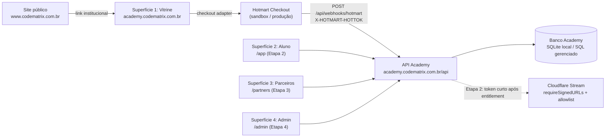

# Arquitetura — CodeMatrix Academy

## Decisão arquitetural (menor stack compatível)

O site corporativo (`CodeMatrix-Agency/site/codematrix-corporate-live`) já padroniza **Next.js 16 + React 19 + TypeScript 5.9 + ESLint 9 + Node >= 22.13**. A plataforma web da CodeMatrix Academy adota a mesma stack em `platform/` dentro do repositório dedicado `anderzilla/codematrix-academy`, preservando tanto a fábrica de cursos Python (`rendaextra/`) quanto o isolamento do site corporativo:

1. **Isolamento total do site público (`www.codematrix.com.br`):** o site corporativo não é migrado para a Academy e continua sem acesso ao banco, webhooks ou sessões da Academy.
2. **Persistência estruturada nativa (`node:sqlite`):** utiliza `DatabaseSync` nativo do Node.js >= 22.13/24, com consultas 100% parametrizadas e sem dependências nativas externas no Windows/Linux. O contrato de repositório em `src/lib/catalog.ts` e `src/lib/payments/hotmart.ts` permite migrar para PostgreSQL/Cloud SQL em produção mantendo o mesmo modelo relacional.
3. **Multi-curso desde o primeiro commit:** todas as tabelas de catálogo, ofertas, cupons e eventos de pagamento referenciam `course_id` (e `tenant_id`), permitindo cadastrar novos cursos sem alterar o schema.
4. **Backend como autoridade:** gabaritos de quizzes (`quiz_questions.correct_index`), regras de acesso, validação de webhooks e emissão futura de tokens Cloudflare Stream nunca ficam no bundle do navegador.

## Diagrama das quatro superfícies e integrações

## Separação lógica de superfícies

| Superfície | Rota | Estado na Etapa 1 | Política de acesso |
|---|---|---|---|
| Vitrine pública | `/`, `/cursos`, `/cursos/[slug]`, `/oferta/[offerCode]`, `/suporte`, `/privacidade`, `/termos` | Implementada | Pública; lê apenas cursos/ofertas `published` |
| Área do aluno | `/app` | Contrato e gate de acesso | Exige sessão autenticada + `entitlement` (Etapa 2) |
| Painel de parceiros | `/partners` | Contrato e gate de acesso | Exige papel `instructor`, `affiliate`, `seller` ou `partner` com escopo (Etapa 3) |
| Painel administrativo | `/admin` | Contrato e gate de acesso | Exige `admin` ou `ops_support` com MFA (Etapa 4) |

## Modelo de dados (Etapa 1)

- `tenants`: isolamento multi-marca (padrão `codematrix`).
- `courses` e `course_versions`: metadados de curso, slug único, status (`draft`, `published`, `archived`) e versionamento.
- `modules`, `blocks`, `lessons`, `assets`: hierarquia pedagógica fiel (`course → module → block → lesson → asset`). Módulos futuros usam `status = 'planned'` e não criam aulas inexistentes.
- `quiz_questions`: banco de questões e gabarito armazenados exclusivamente no servidor (não expostos na API da vitrine).
- `offers` e `coupons`: ofertas/SKUs vinculadas a `course_id`, com distinção entre `published` e `draft`, suporte a amostra gratuita (`is_free = 1`) e mapeamento para `hotmart_product_id` / `hotmart_offer_code`.
- `payment_events`: trilha idempotente (`UNIQUE(provider, provider_event_id)`) com payload sanitizado, hash SHA-256 do payload e hash do e-mail do comprador. Nenhum dado de cartão ou segredo é persistido.
- `cms_pages`: páginas institucionais editáveis (`suporte`, `privacidade`, `termos`) com marcação explícita de revisão jurídica/operacional.

## Decisões registradas

- **DEC-ACADEMY-01:** Aplicação Next.js dedicada em `site/codematrix-academy` na porta local `3100` (reservando `3000` para o site corporativo, `8080` para Agency e `8000` para Hub).
- **DEC-ACADEMY-02:** Sessão e cookies da Academy isolados com prefixo `cm_academy_*`, `HttpOnly`, `SameSite=Lax` e `Secure` em produção.
- **DEC-ACADEMY-03:** Hotmart como adapter desacoplado; em produção sem `HOTMART_HOTTOK`, o webhook falha fechado (`503`) e o checkout não simula aprovação.
- **DEC-ACADEMY-04:** Na Etapa 1, eventos válidos da Hotmart são persistidos com `entitlement_status = 'deferred_to_stage_2'` até a entrega do serviço central de entitlements na Etapa 2.
