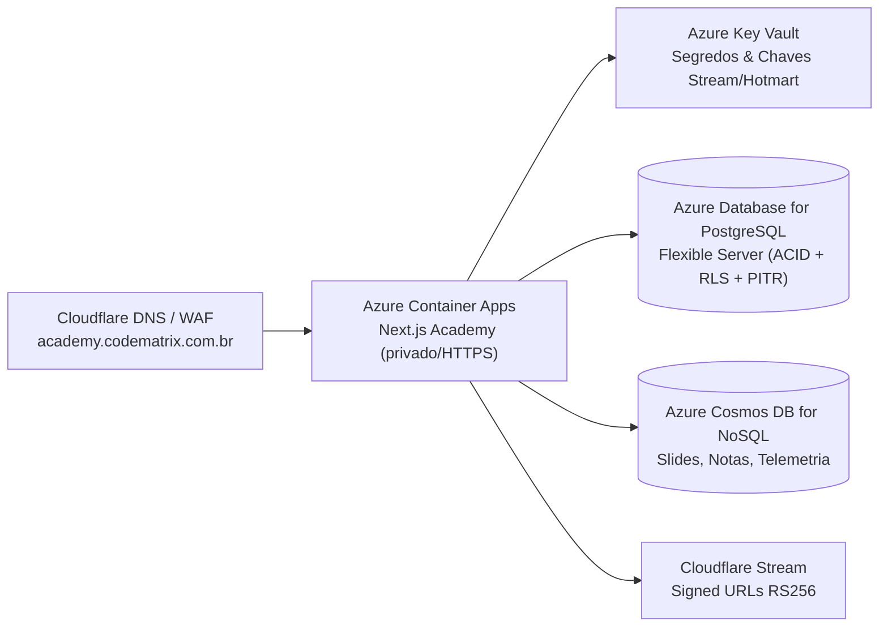

# Arquitetura Híbrida de Dados no Azure (PostgreSQL + NoSQL)

Para atender aos requisitos de **alta segurança, integridade financeira/acadêmica e compatibilidade com a plataforma Azure da CodeMatrix**, a CodeMatrix Academy adota uma arquitetura de persistência híbrida desacoplada por adapters:

## 1. Banco Transacional Relacional — Azure Database for PostgreSQL Flexible Server
- **Papel:** fonte de verdade ACID para usuários, papéis (RBAC), sessões, catálogo multi-curso, pedidos/eventos Hotmart idempotentes, direitos (`entitlements` + `entitlement_history`), regras e snapshots de comissão (`commission_rules`, `commission_entries`), lotes de repasse (`payout_batches`) e auditoria (`audit_events`).
- **DDL versionado:** [db/postgres/schema.sql](../db/postgres/schema.sql) (PostgreSQL 16 com `TIMESTAMPTZ`, `JSONB`, chaves estrangeiras estritas e exemplo de **Row-Level Security — RLS** por `partner_id`).
- **Segurança no Azure:**
  - Conexão exclusivamente por **Private Endpoint / VNet** com TLS obrigatório (`sslmode=verify-full`).
  - Autenticação preferencial via **Microsoft Entra ID / Managed Identity** (sem senhas estáticas no código).
  - Criptografia em repouso gerenciada (CMK via **Azure Key Vault** opcional) e **Point-in-Time Restore (PITR)** diário.
- **Desenvolvimento local:** `ACADEMY_SQL_DRIVER=sqlite` mantém `node:sqlite` para testes locais rápidos e determinísticos; em produção/staging Azure usa-se `ACADEMY_SQL_DRIVER=postgres` + `DATABASE_URL`.

## 2. Banco NoSQL Documental — Azure Cosmos DB for NoSQL
- **Papel:** armazenamento escalável de documentos flexíveis e alto volume de leitura/escrita sem comprometer a integridade do banco transacional:
  - Conteúdo rico de aulas/slides e anotações do aluno (*"Pare e Anote"*);
  - Snapshots de tentativas de quiz e eventos de cliques/telemetria sem PII;
  - Cache de leitura do catálogo público.
- **Adapter:** [src/lib/persistence/nosql.ts](../src/lib/persistence/nosql.ts) (`ACADEMY_NOSQL_DRIVER=local|cosmos`), com particionamento por `tenantId`/`partnerId` e modo **fail-closed** quando `cosmos` está ativo sem credenciais.
- **Segurança no Azure:** RBAC nativo do Cosmos DB via Managed Identity, firewall/Private Link, criptografia em repouso e segredos exclusivamente no **Azure Key Vault**.

## 3. Topologia recomendada no Azure

